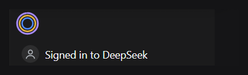
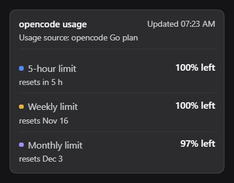

# DeepSeek Harness plugin: opencode usage ring

A small circular gauge for the sidebar footer of the [DeepSeek Harness](https://github.com/deepseek-ai/deepseek-harness) desktop app. It shows how much of your **opencode Go plan** is left, for the three limits opencode tracks: the rolling 5-hour window, the week, and the month.



Three rings, one per window:

| Ring | Window | Colour | Meaning |
|---|---|---|---|
| inner | 5-hour | blue `#4f8cff` | a full ring is a full allowance |
| middle | weekly | yellow `#e3b341` | the ring drains as you spend |
| outer | monthly | violet `#a78bfa` | |

Any ring turns **red `#e5484d`** only when that window has **20% or less left**, or when opencode reports a rate limit. Nothing else uses red.

Click the circle for the same numbers as text, with reset times:



The dot in front of each row is the colour of its ring.

## How the numbers are made

opencode publishes your plan usage itself. The plugin asks for it and draws it — no counting, no estimating, no scraping.

```
DSH client half  ──GET /opencode-usage-ring/data──▶  DSH host half
        ▲                                                   │
        └────────────── JSON, cached 60 s ──────────────────┘
                                                            │
                                        GET https://opencode.ai/zen/go/v1/usage
                                        Authorization: Bearer <your opencode key>
```

The host half reads the key opencode already stored in `%USERPROFILE%\.local\share\opencode\auth.json` (the `opencode-go` entry, or the `OPENCODE_GO_API_KEY` environment variable when that file has none). The response looks like this:

```json
{
  "usage": {
    "rolling": { "status": "ok", "percent": 2,  "resetsAt": "2026-11-08T11:48:28.000Z" },
    "weekly":  { "status": "ok", "percent": 4,  "resetsAt": "2026-11-09T00:00:00.000Z" },
    "monthly": { "status": "ok", "percent": 2,  "resetsAt": "2026-12-03T18:06:43.000Z" }
  }
}
```

`percent` is how much is **used**, so the ring draws `100 - percent`. If a request fails, the last good reading stays on the card with its timestamp instead of emptying the circle.

Nothing is written anywhere: one GET request leaves the machine every 60 seconds at most, and the key is never logged or displayed.

## Requirements

- The DeepSeek Harness desktop app (developed against `0.2.2-rc.1`).
- opencode with an opencode Go plan, already signed in (`opencode auth login`).

## Install

Get the code first:

```powershell
git clone https://github.com/lancelotmolatelo-cpu/deepseek-harness-plugin-opencode-usage-ring.git
```

### Easiest: let DSH install it

Open a DSH session and ask:

> Install the plugin bundle from `C:\path\to\opencode-usage-ring`.

The agent runs the plugin manager's `install_bundle`, which links the folder into your profile, adds the bundle to the profile's bundle list, and enables it. The circle appears in the sidebar footer immediately; if it does not, reload the page with `Ctrl+R`.

### Manual

1. Copy this folder somewhere permanent, for example `C:\plugins\opencode-usage-ring`.
2. Open `%USERPROFILE%\.dsh\profiles\desktop\package.json` and add two entries:

```json
{
  "dependencies": {
    "@local/opencode-usage-ring": "link:C:/plugins/opencode-usage-ring"
  },
  "dsh": {
    "profile": {
      "bundles": [
        "@deepseek-ai/dsh-base",
        "@deepseek-ai/dsh-web-app",
        "@local/opencode-usage-ring"
      ]
    }
  }
}
```

3. In that same folder run `pnpm install` (it makes the `link:` dependency real).
4. Restart DSH.

The Plugins page then lists **opencode usage ring** with its icon and description.

## Build it yourself

A DSH plugin is a small npm package with **two halves**: a host half that runs in the app's Node process, and a client half that runs in the Web GUI. They talk over one local HTTP route.

### 1. The manifest: `package.json`

```json
{
  "name": "@local/opencode-usage-ring",
  "version": "1.0.0",
  "private": true,
  "type": "module",
  "exports": {
    ".": "./index.js",
    "./client": "./client.js",
    "./locale/*.json": "./locale/*.json",
    "./icon": "./icon.svg"
  },
  "files": ["index.js", "client.js", "cordis.patch.yml", "locale/*.json", "icon.svg"],
  "dsh": {
    "bundle": { "patch": "./cordis.patch.yml" },
    "client": {
      "platform": "web",
      "immediately": true,
      "inject": [
        "@deepseek-ai/dsh-client-ui-sidebar",
        "@deepseek-ai/dsh-client-ui-layout"
      ]
    }
  }
}
```

- `dsh.bundle.patch` names the YAML file that inserts the plugin row.
- `dsh.client` says the browser half exists, targets the Web GUI, and should activate immediately.
- `inject` only orders activation after the sidebar packages. No Harness package is imported — the client half uses plain React from the page's module table.

### 2. The loader row: `cordis.patch.yml`

```yaml
- insert:
    - id: opencode-usage-ring
      name: '@local/opencode-usage-ring'
```

This is how the bundle adds itself to the app's plugin graph.

### 3. The host half: `index.js`

It exports `apply(ctx)`. Inside, wait for the web server service and register one route:

```js
export function apply(ctx) {
  useService(ctx, 'webServer', (webServer) => {
    ctx.effect(() => webServer.register({
      kind: 'exact',
      path: '/opencode-usage-ring/data',
      handler: handleRequest,
    }));
  });
}
```

`ctx.get('webServer')` is a snapshot of the moment it is called, so `useService` retries for up to ten seconds instead of silently giving up when the server activates later. Everything registered inside `ctx.effect` is removed when the plugin unloads.

The handler is plain Node: read the stored key, call the usage endpoint, cache the answer for a minute.

```js
const response = await fetch('https://opencode.ai/zen/go/v1/usage', {
  headers: { authorization: `Bearer ${key}`, accept: 'application/json' },
  signal: AbortSignal.timeout(12000),
});
```

The full file also covers: finding `auth.json` on Windows and Linux, mapping the three windows, a cache that survives a failed request, and friendly error text for a refused key or a dead connection.

### 4. The client half: `client.js`

The browser loads it as a module factory. React comes from the page:

```js
window.__ModuleLoader__.load({
  id: '@local/opencode-usage-ring',
  factory(require) {
    const React = require('react');
    const h = React.createElement;
    // ... component code ...
    return {
      inject: ['slots'],
      apply(ctx) {
        ctx.slots.inject('sidebar.footer.action', () =>
          ctx.slots.register(
            { name: 'sidebar.footer.action', id: 'opencode-usage', order: 10, label: 'opencode usage' },
            UsageRing,
          ),
        );
      },
    };
  },
});
```

`sidebar.footer.action` is the additive seat beside the Settings row at the sidebar foot — the only spare seat there that does not replace shipped UI. `ctx.slots.inject` is declaration-aware, so this works whether the sidebar activates before or after the plugin.

The component itself:

- polls the host route every 60 seconds, and again on window focus;
- draws three `<circle>` elements with `stroke-dasharray`, one per window;
- renders the card as a `position: fixed` panel placed from the button's `getBoundingClientRect()`, so the sidebar's scroll container cannot clip it;
- closes the card on an outside click or `Escape`;
- registers its strings with `ctx.locale` so the card can be translated.

Styling follows the app: surfaces, borders and text use the theme's `--dsw-alias-*` tokens; only the gauge arcs use fixed colours, because a gauge has to read the same on a dark and a light sidebar.

### 5. Display metadata: `locale/` and `icon.svg`

The Plugins page shows a bundle before it is activated, so it needs a title, a description and an icon that do not depend on running code:

```json
{ "meta": { "title": "opencode usage ring", "description": "A circle beside the sidebar account row that shows how much of the opencode Go plan is left for the 5-hour, weekly and monthly limits." } }
```

Both are exported from `package.json` (`./locale/*.json`, `./icon`).

### 6. Check it

With the plugin installed, the route answers on its own:

```powershell
Invoke-WebRequest http://127.0.0.1:<port>/opencode-usage-ring/data -UseBasicParsing | Select-Object -ExpandProperty Content
```

`<port>` is the one the app picked for its Web GUI on that launch; it changes from start to start, and the app prints its URL.

## Customise

Everything below lives in `client.js`.

| What | Where | Default |
|---|---|---|
| Ring colours | `TONES` object | blue / yellow / violet |
| Red threshold | `LOW_LEFT_PERCENT` | `20` |
| Ring order | the `rings` array in `RingGlyph` | month outer, 5-hour inner |
| Poll interval | `REFRESH_MS` | `60 * 1000` |
| Card width | `CARD_WIDTH` and `.ocur-card` | `264px` |

You can check the colour logic without the app: the threshold applies per window, so a window at 15% left draws red while a window at 96% keeps its own colour.

## Troubleshooting

| Symptom | Cause and fix |
|---|---|
| No circle at all | The sidebar is collapsed or hidden. Expand it — the circle lives in the footer, next to the account row. |
| Circle shows a dashed grey ring | The route has no answer yet; the first request was still running. It fills in within a second. |
| `The opencode Go API key was refused` | The stored key is stale. Run `opencode auth login` again. |
| `Could not reach opencode.ai` | No network, or a proxy blocking the request. |
| `Last reading 10:55` in yellow | The newest request failed; the card keeps the previous numbers instead of emptying. |
| Card will not stay open | Another plugin that replaces the sidebar footer may be fighting for the same seat. |

## Licence

MIT. See [LICENSE](LICENSE).
